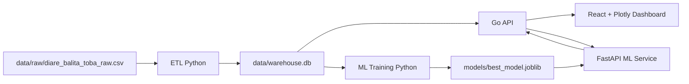
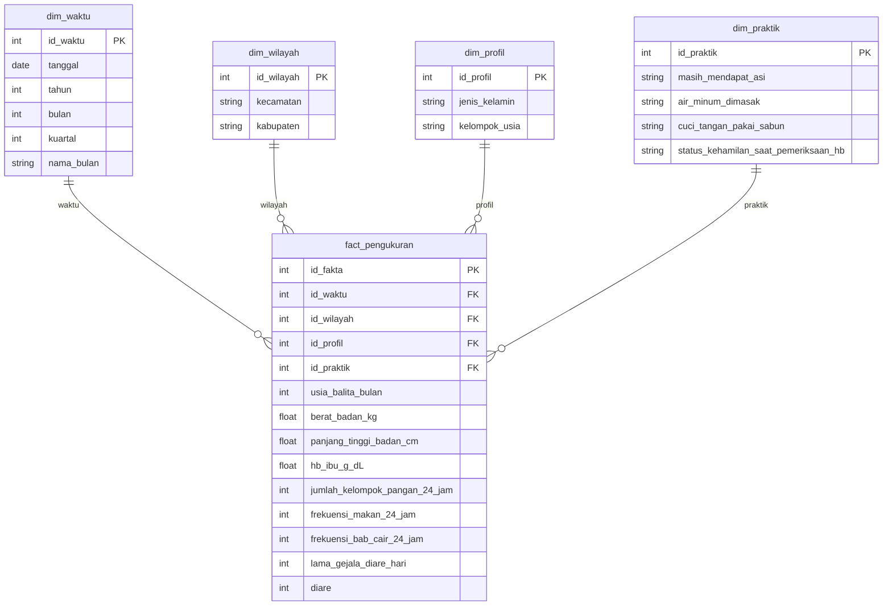
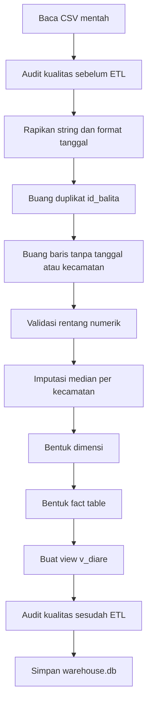

# Dokumentasi Fitur dan Progres Sistem

Dokumen ini menjelaskan isi proyek **Dashboard Analitik Diare Balita Kabupaten Toba**, alasan desain teknisnya, fitur yang sudah dibuat, alur data, model machine learning, jenis diagram, serta batasan yang perlu disampaikan saat laporan progres kepada dosen pembimbing.

> **Status dokumen:** dokumentasi progres berdasarkan implementasi repository saat ini.  
> **Catatan:** angka dan nama model diambil dari data dan artefak proyek yang tersedia, bukan angka contoh.

---

## 1. Ringkasan proyek

Proyek ini membangun sistem analitik kesehatan untuk membaca pola diare pada balita di Kabupaten Toba. Sistem menggabungkan:

1. **Data mentah CSV** sebagai sumber pengukuran.
2. **ETL Python** untuk pembersihan, validasi, dan pembentukan data warehouse.
3. **Warehouse SQLite** dengan skema bintang.
4. **API Go** untuk query agregasi dashboard.
5. **Dashboard React dan Plotly** untuk eksplorasi dan storytelling.
6. **Model klasifikasi machine learning** untuk memperkirakan probabilitas diare.
7. **FastAPI** untuk menjalankan prediksi dan mengelola proses data.

Sistem tidak dimaksudkan sebagai alat diagnosis medis. Hasil analitik dan prediksi dipakai sebagai alat bantu untuk membaca pola, menentukan prioritas pemantauan, dan mendukung diskusi pencegahan.

### Tujuan sistem

- Menampilkan kondisi diare balita secara ringkas dan mudah dibaca.
- Membandingkan prevalensi antar kecamatan.
- Membaca pola waktu dan pola kelompok usia.
- Membandingkan praktik rumah tangga seperti air minum, cuci tangan, dan ASI.
- Menjelaskan temuan melalui halaman storytelling berbasis data.
- Menguji satu profil balita menggunakan model klasifikasi.
- Memungkinkan data CSV diproses ulang melalui halaman Kelola data.

### Pengguna yang dituju

- Tim proyek dan mahasiswa.
- Dosen pembimbing saat evaluasi progres.
- Pengelola program kesehatan.
- Kader atau petugas yang memiliki konteks lapangan.

---

## 2. Fakta dataset saat ini

Fakta berikut dibaca dari `data/raw/diare_balita_toba_raw.csv` dan `data/warehouse.db`.

| Komponen | Nilai |
|---|---:|
| Jumlah baris data mentah | 5.000 |
| Jumlah kolom data mentah | 20 |
| Periode pengukuran | 2020-01-02 sampai 2026-10-31 |
| Jumlah kecamatan | 16 |
| Target diare “Ya” | 675 baris |
| Target diare “Tidak” | 4.325 baris |
| Baris pada fact table | 5.000 |
| Baris `dim_waktu` | 2.147 |
| Baris `dim_wilayah` | 16 |
| Baris `dim_profil` | 10 |
| Baris `dim_praktik` | 16 |

### Kecamatan yang tercakup

Data mencakup 16 kecamatan:

- Ajibata
- Balige
- Bonatua Lunasi
- Borbor
- Habinsaran
- Laguboti
- Lumban Julu
- Nassau
- Parmaksian
- Pintu Pohan Meranti
- Porsea
- Siantar Narumonda
- Silaen
- Sigumpar
- Tampahan
- Uluan

### Kolom data mentah

File raw memiliki 20 kolom:

1. `id_balita`
2. `kabupaten`
3. `kecamatan`
4. `tanggal_pengukuran`
5. `usia_balita_bulan`
6. `jenis_kelamin`
7. `berat_badan_kg`
8. `panjang_tinggi_badan_cm`
9. `id_ibu`
10. `hb_ibu_g_dL`
11. `status_kehamilan_saat_pemeriksaan_hb`
12. `trimester_saat_pemeriksaan_hb`
13. `masih_mendapat_asi`
14. `jumlah_kelompok_pangan_24_jam`
15. `frekuensi_makan_24_jam`
16. `air_minum_dimasak`
17. `cuci_tangan_pakai_sabun`
18. `frekuensi_bab_cair_24_jam`
19. `lama_gejala_diare_hari`
20. `gejala_diare_14_hari_terakhir`

Kolom terakhir menjadi sumber target klasifikasi. Di warehouse, target tersebut diubah menjadi kolom biner `diare`.

---

## 3. Arsitektur sistem

### Diagram arsitektur umum



### Penjelasan alur

1. CSV mentah disimpan di `data/raw/`.
2. `etl/etl_pipeline.py` membaca CSV, membersihkan nilai, memvalidasi rentang, membuat dimensi, dan menyimpan warehouse.
3. `data/warehouse.db` menjadi sumber bersama untuk API analitik dan training model.
4. Go API menjalankan query agregasi seperti KPI, tren, peringkat kecamatan, heatmap, sanitasi, dan scatter.
5. React mengambil data dari API dan menampilkannya dalam kartu KPI, chart, ranking, tabel, dan laporan storytelling.
6. `ml/train.py` mengambil data dari view `v_diare`, melatih tiga pendekatan klasifikasi, lalu menyimpan model terbaik.
7. FastAPI memuat model tersimpan dan menyediakan endpoint prediksi.
8. Go API mem-proxy endpoint FastAPI agar frontend cukup berkomunikasi dengan satu server utama.

### Pembagian tanggung jawab teknologi

| Teknologi | Tanggung jawab |
|---|---|
| Python, pandas | Membaca dan mengolah data |
| SQLite | Menyimpan warehouse lokal dan view analitik |
| Go | API agregasi berperforma ringan dan proxy layanan model |
| React | Komponen halaman dan state filter |
| Plotly | Diagram interaktif |
| FastAPI | Prediksi, metrik model, dan pengelolaan ETL |
| scikit-learn | Training, cross-validation, evaluasi, dan pipeline model |
| Vite | Development server dan build frontend |

---

## 4. Data warehouse dan jenis diagram basis data

### Jenis model data

Warehouse menggunakan **skema bintang (star schema)**. Skema ini dipilih karena dashboard sering melakukan agregasi berdasarkan waktu, wilayah, profil, dan praktik rumah tangga.

- **Fact table:** menyimpan satu baris pengukuran balita.
- **Dimension table:** menyimpan konteks pengukuran.
- **Analytical view:** menggabungkan fact dan dimension agar query API lebih sederhana.

### Diagram skema bintang



### Tabel dan view

#### `fact_pengukuran`

Menyimpan pengukuran utama:

- identitas fakta,
- foreign key ke dimensi,
- usia,
- berat dan tinggi,
- Hb ibu,
- pola makan,
- frekuensi BAB cair,
- lama gejala,
- target biner `diare`.

#### `dim_waktu`

Memecah tanggal menjadi atribut waktu yang mudah diagregasi:

- tanggal,
- tahun,
- bulan,
- kuartal,
- nama bulan.

#### `dim_wilayah`

Menyimpan kecamatan dan kabupaten. Saat ini seluruh data berada pada Kabupaten Toba.

#### `dim_profil`

Menyimpan jenis kelamin dan kelompok usia:

- `0-5 bln`
- `6-11 bln`
- `12-23 bln`
- `24-35 bln`
- `36-59 bln`

#### `dim_praktik`

Menyimpan kombinasi praktik rumah tangga dan konteks kehamilan:

- masih mendapat ASI,
- air minum dimasak,
- cuci tangan pakai sabun,
- status kehamilan saat pemeriksaan Hb.

#### `v_diare`

View ini menggabungkan fact table dengan semua dimensi. API dan training model menggunakan view ini agar tidak perlu mengulang join di banyak tempat.

---

## 5. ETL dan kualitas data

File utama: [`etl/etl_pipeline.py`](./etl/etl_pipeline.py)

### Tahapan ETL



### Pembersihan yang dilakukan

- Spasi pada nilai teks dihapus.
- Nama kecamatan dinormalisasi dengan format title case.
- Tanggal diubah menjadi tipe tanggal.
- Duplikat berdasarkan `id_balita` dibuang.
- Baris tanpa tanggal atau kecamatan dibuang.
- Nilai di luar rentang wajar diubah menjadi nilai kosong.
- Nilai numerik kosong diimputasi menggunakan median per kecamatan.
- Nilai trimester kosong diubah menjadi `0`, yang berarti tidak hamil atau tidak berlaku.
- Target `Ya/Tidak` dipetakan menjadi `1/0`.

### Rentang validasi numerik

| Kolom | Rentang |
|---|---:|
| Usia balita | 0 sampai 59 bulan |
| Berat badan | 2 sampai 30 kg |
| Panjang/tinggi badan | 40 sampai 125 cm |
| Hb ibu | 5 sampai 18 g/dL |
| Kelompok pangan | 0 sampai 10 |
| Frekuensi makan | 0 sampai 10 |
| Frekuensi BAB cair | 0 sampai 20 |
| Lama gejala diare | 0 sampai 14 hari |

### Dimensi kualitas yang diukur

ETL menghasilkan `docs/laporan_kualitas_data.json` dengan empat dimensi:

1. **Completeness:** seberapa lengkap kolom wajib terisi.
2. **Validity:** seberapa banyak nilai berada dalam rentang wajar.
3. **Consistency:** apakah hubungan antar kolom masuk akal.
4. **Uniqueness:** apakah `id_balita` tidak berulang.

### Alasan memakai ETL terpisah

ETL dipisahkan dari frontend agar:

- pembersihan data dapat dijalankan ulang,
- aturan validasi terdokumentasi di satu tempat,
- API dan model memakai sumber data yang sama,
- perubahan data dapat direproduksi,
- kesalahan data dapat ditemukan sebelum masuk ke dashboard.

---

## 6. API dan kontrak data

File utama: [`backend/main.go`](./backend/main.go)

Go API membaca `data/warehouse.db` dalam mode read-only untuk query dashboard.

### Endpoint analitik

| Endpoint | Fungsi |
|---|---|
| `GET /api/kpi` | Jumlah balita, prevalensi, rata-rata lama gejala, persentase air dimasak, dan cuci tangan |
| `GET /api/trend` | Tren prevalensi per tahun dan bulan |
| `GET /api/by-kecamatan` | Jumlah data dan prevalensi per kecamatan |
| `GET /api/heatmap` | Prevalensi per kecamatan dan tahun |
| `GET /api/by-usia` | Prevalensi menurut kelompok usia dan jenis kelamin |
| `GET /api/sanitasi` | Agregasi praktik rumah tangga dan jumlah kasus |
| `GET /api/scatter` | Sampel data antropometri untuk scatter dan analisis lanjutan |

### Endpoint model dan pengelolaan data

| Endpoint | Fungsi |
|---|---|
| `GET /api/model-metrics` | Mengambil metrik training dan evaluasi |
| `POST /api/predict` | Mengirim profil balita untuk prediksi |
| `GET /api/data/info` | Informasi raw data, kualitas, dan model aktif |
| `GET /api/data/preview` | Pratinjau raw data dengan pagination |
| `GET /api/data/download` | Mengunduh CSV saat ini |
| `GET /api/data/template` | Mengunduh template kolom wajib |
| `GET /api/data/job` | Memantau status ETL atau training |
| `POST /api/data/upload` | Validasi dan unggah CSV baru |
| `POST /api/data/reprocess` | Menjalankan ulang ETL, dengan opsi training ulang |

### Filter global

Endpoint analitik menerima filter query yang di-whitelist:

- `tahun`
- `kecamatan`
- `kelompok_usia`
- `jenis_kelamin`
- `masih_mendapat_asi`
- `air_minum_dimasak`
- `cuci_tangan_pakai_sabun`

Frontend memakai filter tahun dan kecamatan secara langsung pada halaman Ringkasan, Analisis mendalam, dan Cerita keputusan.

---

## 7. Fitur halaman dashboard

### 7.1 Ringkasan

Halaman Ringkasan adalah halaman awal untuk menjawab kondisi utama dengan cepat.

#### Komponen

1. **Kartu KPI**
   - Balita terdata.
   - Prevalensi diare.
   - Rata-rata lama gejala.
   - Persentase air minum yang dimasak.

2. **Grafik tren**
   - Membandingkan seluruh Kabupaten Toba dengan pilihan kecamatan.
   - Menampilkan prevalensi per bulan.
   - Memberi anotasi pada titik puncak.

3. **Peringkat kecamatan**
   - Mengurutkan kecamatan berdasarkan prevalensi.
   - Dapat diklik untuk mengaktifkan filter kecamatan.
   - Klik ulang dapat melepas filter.

4. **Kartu temuan**
   - Menyorot kecamatan dengan prevalensi tertinggi.
   - Membandingkan prevalensi berdasarkan praktik air minum.
   - Menyampaikan rekomendasi pencegahan dengan bahasa nonteknis.

#### Jenis diagram

- KPI card untuk ringkasan angka.
- Line chart untuk tren waktu.
- Ranking list dengan bar horizontal untuk perbandingan wilayah.
- Kartu narasi untuk interpretasi dan rekomendasi.

---

### 7.2 Analisis mendalam

Halaman ini digunakan ketika pengguna ingin melihat pola yang tidak cukup dijelaskan oleh KPI.

#### Komponen dan tujuan analitik

1. **Heatmap kecamatan x tahun**
   - Menjawab kecamatan mana yang konsisten tinggi atau rendah.
   - Tahun dapat diklik untuk mengubah filter global.

2. **Bar chart kelompok usia dan jenis kelamin**
   - Membandingkan prevalensi lima kelompok usia.
   - Memisahkan laki-laki dan perempuan.

3. **Bar chart praktik rumah tangga**
   - Membandingkan nilai Ya dan Tidak untuk air dimasak, cuci tangan, dan ASI.
   - Menunjukkan hubungan deskriptif, bukan bukti sebab-akibat.

4. **Scatter plot usia dan berat badan**
   - Menunjukkan tumpang tindih distribusi balita diare dan tidak diare.
   - Membantu menghindari kesimpulan bahwa satu ukuran tubuh saja menentukan target.

5. **Box plot berat badan**
   - Membandingkan median, sebaran, dan pencilan berat badan berdasarkan status diare.

6. **Treemap kecamatan**
   - Menunjukkan kontribusi jumlah data per kecamatan.
   - Diagram ini menunjukkan volume data, bukan tingkat risiko.

7. **Parallel coordinates**
   - Membaca beberapa fitur numerik sekaligus.
   - Warna membedakan status diare.

#### Jenis diagram yang digunakan

- Heatmap.
- Grouped bar chart.
- Scatter plot.
- Box plot.
- Treemap.
- Parallel coordinates.

---

### 7.3 Cerita keputusan

Halaman Cerita keputusan dibuat sebagai laporan eksekutif satu halaman yang dapat di-scroll. Prinsipnya adalah sistem yang bercerita, sementara pengguna membaca jawaban yang sudah diringkas.

#### Struktur narasi

1. **Header cerita**
   - Pertanyaan keputusan utama.
   - Executive summary dinamis.
   - Sumber data, periode data, dan jumlah baris.

2. **Q&A kondisi keseluruhan**
   - Menjelaskan prevalensi keseluruhan dan arah tren.
   - Menggabungkan line chart dan KPI mini.

3. **Q&A wilayah prioritas**
   - Menunjukkan kecamatan tertinggi dan terendah.
   - Menggabungkan bar ranking dan treemap.

4. **Q&A pola waktu**
   - Menunjukkan puncak dan lembah periode.
   - Menggunakan line chart dengan anotasi.

5. **Q&A faktor praktik rumah tangga**
   - Membandingkan air minum, cuci tangan, dan ASI.
   - Menggunakan chart perbandingan dan distribusi pendukung.

6. **Q&A model prediksi**
   - Menjelaskan bahwa model adalah alat bantu penyaringan.
   - Membandingkan AUC data uji dari tiga pendekatan.
   - Menghubungkan pembaca ke halaman Prediksi risiko.

7. **Tabel rekomendasi**
   - Prioritas.
   - Tindakan.
   - Penanggung jawab.
   - Dasar temuan.
   - Indikator keberhasilan.

#### Prinsip data dinamis

Narasi tidak boleh bergantung pada angka manual. Komponen mengambil nilai dari:

- `kpi`,
- `kec`,
- `trend`,
- `heat`,
- `san`,
- `scatter`,
- `modelMetrics`.

Karena itu, angka, nama kecamatan, periode puncak, dan arah perbandingan berubah mengikuti filter.

#### Catatan kehati-hatian

Halaman ini membedakan hubungan statistik dari sebab-akibat. Contoh, perbedaan prevalensi antara keluarga yang memasak air dan yang tidak memasak air tidak otomatis membuktikan bahwa satu faktor menjadi penyebab tunggal.

---

### 7.4 Prediksi risiko

Halaman Prediksi risiko menerima satu profil balita dan mengirimkannya ke FastAPI.

#### Input yang digunakan

- Usia balita.
- Jenis kelamin.
- Kecamatan.
- Berat badan.
- Panjang atau tinggi badan.
- Hb ibu.
- Status kehamilan ibu.
- Status ASI.
- Jumlah kelompok pangan.
- Frekuensi makan.
- Air minum dimasak.
- Cuci tangan pakai sabun.
- Bulan pengukuran.

#### Output

- Probabilitas diare.
- Kelas `Ya` atau `Tidak`.
- Kategori risiko:
  - Rendah jika probabilitas di bawah 0,25.
  - Sedang jika probabilitas minimal 0,25 dan di bawah 0,5.
  - Tinggi jika probabilitas minimal 0,5.

#### Validasi input

FastAPI memakai Pydantic untuk membatasi rentang numerik:

- usia 0 sampai 59 bulan,
- berat 2 sampai 30 kg,
- tinggi 40 sampai 125 cm,
- Hb 5 sampai 18 g/dL,
- kelompok pangan 0 sampai 10,
- frekuensi makan 0 sampai 10,
- bulan 1 sampai 12.

Input di luar rentang menghasilkan respons validasi, bukan prediksi diam-diam.

#### Batas penggunaan

Prediksi tidak menggantikan pemeriksaan klinis. Hasil perlu dikonfirmasi oleh petugas yang memahami konteks lapangan.

---

### 7.5 Kelola data

Halaman Kelola data memungkinkan tim mengoperasikan alur data tanpa mengedit database secara manual.

#### Fitur

- Melihat jumlah baris raw data.
- Melihat jumlah kolom.
- Melihat waktu pembaruan terakhir.
- Melihat model aktif dan AUC uji.
- Mengunggah CSV baru.
- Validasi kolom wajib.
- Mendeteksi tipe data numerik yang tidak valid.
- Mendeteksi tanggal tidak valid.
- Memberi peringatan untuk ID duplikat.
- Memberi peringatan jika jumlah baris di bawah 5.000.
- Mencadangkan CSV lama sebelum penggantian.
- Memilih apakah model dilatih ulang.
- Memproses ulang data saat ini.
- Memantau status pekerjaan ETL dan training.
- Melihat laporan kualitas data.
- Mengunduh CSV saat ini.
- Mengunduh template kolom wajib.
- Melihat preview data dengan pagination.

#### State yang tersedia

- Loading atau proses sedang berjalan.
- Berhasil.
- Peringatan.
- Error validasi.
- Error layanan.
- Empty state ketika data belum tersedia.

---

## 8. Model machine learning

File utama: [`ml/train.py`](./ml/train.py)

### Jenis masalah

Model menyelesaikan masalah **klasifikasi biner**:

- `1`: diare “Ya”.
- `0`: diare “Tidak”.

Target diambil dari `gejala_diare_14_hari_terakhir`.

### Fitur model

#### Fitur numerik

- `usia_balita_bulan`
- `berat_badan_kg`
- `panjang_tinggi_badan_cm`
- `hb_ibu_g_dL`
- `jumlah_kelompok_pangan_24_jam`
- `frekuensi_makan_24_jam`
- `bb_per_tb`
- `bulan`

`bb_per_tb` adalah fitur turunan:

```text
bb_per_tb = berat_badan_kg / panjang_tinggi_badan_cm
```

#### Fitur kategorikal

- `jenis_kelamin`
- `kecamatan`
- `masih_mendapat_asi`
- `air_minum_dimasak`
- `cuci_tangan_pakai_sabun`
- `status_kehamilan_saat_pemeriksaan_hb`

Fitur kategorikal diproses dengan `OneHotEncoder(handle_unknown="ignore")` agar kategori baru tidak langsung menyebabkan prediksi gagal.

### Fitur yang sengaja dikeluarkan

Dua kolom berikut tidak dipakai sebagai fitur model:

- `frekuensi_bab_cair_24_jam`
- `lama_gejala_diare_hari`

Alasannya adalah **target leakage**. Kedua variabel tersebut sangat dekat dengan definisi atau konsekuensi langsung dari diare. Jika digunakan, model bisa terlihat bagus karena membaca jawaban target secara tidak adil, bukan karena belajar pola prediktif yang tersedia sebelum kejadian.

### Tiga pendekatan yang dibandingkan

#### 1. Logistic Regression

Dipakai sebagai **baseline** karena:

- sederhana,
- mudah dijelaskan,
- memberi pembanding awal untuk model non-linear,
- cocok untuk melihat hubungan linear setelah preprocessing.

Fitur numerik diskalakan dengan `StandardScaler`.

#### 2. Random Forest

Dipakai karena:

- dapat membaca hubungan non-linear,
- dapat menggabungkan fitur numerik dan kategorikal setelah encoding,
- relatif kuat pada data tabular,
- tidak membutuhkan asumsi hubungan linear,
- menyediakan probabilitas melalui `predict_proba`.

Model terbaik tersimpan saat ini adalah **Random Forest**.

#### 3. HistGradientBoosting

Dipakai sebagai pembanding ensemble berbasis boosting. Model ini dapat menangkap pola bertahap dan hubungan non-linear yang mungkin tidak tertangkap baseline linear.

### Cara evaluasi

1. Data dibagi menjadi:
   - 80% training,
   - 20% test.
2. Pembagian memakai stratifikasi target.
3. Training memakai `StratifiedKFold` 5 fold.
4. Hyperparameter dipilih dengan `RandomizedSearchCV`.
5. Scoring utama untuk pencarian adalah ROC AUC.
6. Evaluasi test menyimpan:
   - AUC,
   - accuracy,
   - precision,
   - recall,
   - F1,
   - confusion matrix,
   - kurva ROC.
7. Analisis false negative juga disimpan.

### Metrik model saat ini

Sumber: [`models/metrics.json`](./models/metrics.json)

| Model | CV AUC | Test AUC | Accuracy | Precision | Recall | F1 |
|---|---:|---:|---:|---:|---:|---:|
| Logistic Regression (baseline) | 0,6582 | 0,6873 | 0,6070 | 0,2095 | 0,6889 | 0,3212 |
| Random Forest | 0,6596 | 0,6758 | 0,7210 | 0,2410 | 0,4963 | 0,3245 |
| HistGradientBoosting | 0,6486 | 0,6804 | 0,6380 | 0,2112 | 0,6148 | 0,3144 |

### Mengapa Random Forest menjadi model aktif?

Pemilihan model menggunakan skor cross-validation yang menjadi dasar seleksi training. Random Forest memiliki CV AUC tertinggi di antara tiga model pada artefak saat ini, yaitu 0,6596, sehingga disimpan sebagai `models/best_model.joblib`.

Namun, evaluasi juga harus dibaca secara lengkap. Logistic Regression memiliki Test AUC lebih tinggi pada split test yang tersimpan, yaitu 0,6873, sedangkan Random Forest memiliki accuracy dan F1 sedikit lebih tinggi. Hal ini perlu disampaikan secara jujur saat presentasi:

- “Model aktif dipilih berdasarkan CV AUC.”
- “Metrik test tidak selalu memiliki peringkat yang sama.”
- “Model belum boleh disebut sebagai alat diagnosis.”

### Interpretasi metrik

- **AUC:** kemampuan membedakan kelas pada berbagai threshold.
- **Accuracy:** proporsi prediksi benar secara keseluruhan.
- **Precision:** dari prediksi diare, berapa banyak yang benar-benar diare.
- **Recall:** dari kasus diare, berapa banyak yang berhasil ditangkap.
- **F1:** keseimbangan precision dan recall.
- **Confusion matrix:** jumlah true negative, false positive, false negative, dan true positive.

Karena kelas “Ya” lebih sedikit daripada “Tidak”, accuracy tidak boleh menjadi satu-satunya dasar penilaian.

---

## 9. Jenis diagram yang terdapat dalam sistem

| Diagram | Halaman | Tujuan |
|---|---|---|
| KPI card | Ringkasan | Menyajikan angka kunci |
| Line chart | Ringkasan, Cerita | Membaca tren waktu dan puncak |
| Ranking bar | Ringkasan | Membandingkan kecamatan |
| Heatmap | Analisis | Membaca pola kecamatan dan tahun |
| Grouped bar | Analisis | Membandingkan kelompok dan praktik |
| Scatter plot | Analisis | Membaca hubungan usia dan berat badan |
| Box plot | Analisis | Membaca sebaran dan median |
| Treemap | Analisis, Cerita | Membaca komposisi volume data |
| Parallel coordinates | Analisis | Membaca banyak fitur numerik sekaligus |
| ROC curve | Prediksi | Membandingkan performa klasifikasi |
| Tabel metrik | Prediksi | Membaca metrik setiap model |
| Confusion matrix dan false negative table | Prediksi | Membaca jenis kesalahan model |
| ER diagram | Dokumentasi warehouse | Menjelaskan relasi tabel |
| Flowchart ETL | Dokumentasi | Menjelaskan proses data |
| Flowchart arsitektur | Dokumentasi | Menjelaskan hubungan antarlayanan |

### Prinsip pemilihan diagram

- Tren memakai line chart.
- Perbandingan kategori memakai bar chart.
- Pola dua variabel numerik memakai scatter plot.
- Distribusi dan pencilan memakai box plot.
- Komposisi volume memakai treemap.
- Pola dua dimensi memakai heatmap.
- Evaluasi threshold klasifikasi memakai ROC curve.
- Relasi data memakai ER diagram.
- Alur proses memakai flowchart.

---

## 10. Desain antarmuka

### Arah visual

Desain mengikuti gaya **soft structuralism** untuk dashboard kesehatan:

- latar putih dan lavender sangat lembut,
- sidebar putih,
- teks utama navy lembut,
- ungu sebagai warna navigasi dan fokus,
- coral sebagai aksen temuan atau status aktif,
- kartu dengan radius konsisten,
- ruang kosong untuk memisahkan informasi,
- chart memakai warna yang sama dengan sistem visual.

### Alasan desain

- Warna putih dan lavender menjaga dashboard terasa tenang untuk konteks kesehatan.
- Ungu dipakai sebagai aksen navigasi agar fokus pengguna mudah dikenali.
- Coral dipakai terbatas untuk temuan yang perlu perhatian.
- Navy dipakai untuk blok informasi utama dan kontras tinggi.
- Setiap item navbar adalah tombol navigasi, bukan checkbox.
- Halaman “Tentang” sudah dikeluarkan dari navbar agar navigasi tidak terlalu panjang dan tidak menampilkan fitur yang sedang ditunda.
- Fitur map sempat diuji sebagai konsep, tetapi ditunda dan dihapus dari implementasi saat ini karena belum tersedia geometri wilayah yang bersumber langsung dari data raw.

### Aksesibilitas

- Tombol, select, input, dan link memiliki ukuran minimum yang nyaman.
- Fokus keyboard memakai `:focus-visible`.
- State loading, error, empty, dan berhasil ditampilkan melalui teks.
- Warna tidak menjadi satu-satunya penyampai status.
- Teks sekunder dipilih ulang agar tetap terbaca pada latar terang.

---

## 11. Keamanan dan keandalan data

### Query API

Filter query Go API menggunakan daftar kolom yang diizinkan. Nilai filter dikirim sebagai parameter query, bukan disisipkan langsung ke SQL.

### Upload data

Proses upload:

1. Membatasi ukuran file maksimal 20 MB.
2. Membaca UTF-8 atau Latin-1.
3. Menerima separator koma atau titik koma.
4. Memeriksa kolom wajib.
5. Memeriksa kolom numerik.
6. Memeriksa target Ya/Tidak.
7. Memeriksa tanggal.
8. Memberi peringatan ID duplikat.
9. Membuat backup raw data lama.
10. Menjalankan ETL.
11. Opsional menjalankan training ulang.

### Model dan data pribadi

Data memakai kode seperti `B0001` dan `I0001`, bukan nama langsung. Dataset tetap harus diperlakukan sebagai data terbatas dan digunakan sesuai izin tim atau pemilik data.

### Keterbatasan yang harus disampaikan

- Data bersifat proyek dan belum otomatis mewakili seluruh populasi.
- Hubungan pada chart bukan bukti sebab-akibat.
- Model masih memiliki performa moderat.
- Ketidakseimbangan target membuat accuracy perlu dibaca bersama recall, precision, F1, dan AUC.
- Data baru harus melewati validasi dan ETL sebelum dipakai.
- Prediksi bukan diagnosis klinis.
- Status izin penggunaan data, anggota tim, dan pernyataan penggunaan AI masih perlu diisi secara manual pada dokumentasi final jika dibutuhkan.

---

## 12. Cara menjalankan sistem

### Persiapan

```powershell
pip install -r requirements.txt
cd frontend
npm install
```

### Menjalankan ETL

Dari root repository:

```powershell
python etl/etl_pipeline.py
```

Output utama:

- `data/warehouse.db`
- `docs/laporan_kualitas_data.json`

### Training model

```powershell
python ml/train.py
```

Output utama:

- `models/best_model.joblib`
- `models/metrics.json`

### Menjalankan layanan model

```powershell
uvicorn ml_service.main:app --port 8001
```

### Menjalankan Go API

```powershell
cd backend
go run .
```

API akan tersedia di port `8080`.

### Menjalankan frontend development server

```powershell
cd frontend
npm run dev
```

Frontend development server biasanya tersedia di port `5173`.

### Build frontend

```powershell
cd frontend
npm run build
```

Build yang berhasil sudah diverifikasi pada progres proyek saat ini. Vite masih memberi peringatan ukuran bundle Plotly besar, tetapi peringatan tersebut bukan kegagalan build.

---

## 13. Struktur file penting

```text
.
├── backend/
│   ├── main.go
│   ├── go.mod
│   └── go.sum
├── data/
│   ├── raw/
│   │   └── diare_balita_toba_raw.csv
│   └── warehouse.db
├── docs/
│   └── laporan_kualitas_data.json
├── etl/
│   ├── etl_pipeline.py
│   └── ingest.py
├── frontend/
│   └── src/
│       ├── App.jsx
│       ├── KelolaData.jsx
│       ├── components.jsx
│       ├── plot.jsx
│       └── styles.css
├── ml/
│   └── train.py
├── ml_service/
│   └── main.py
├── models/
│   ├── best_model.joblib
│   └── metrics.json
├── README.md
└── fitur.md
```

---

## 14. Progress yang sudah selesai

- [x] Data raw tersedia dan dapat dibaca.
- [x] ETL pembersihan dan validasi dibuat.
- [x] Warehouse SQLite dengan skema bintang dibuat.
- [x] View `v_diare` dibuat untuk kebutuhan analitik.
- [x] API agregasi Go dibuat.
- [x] React dashboard dibuat.
- [x] KPI dan filter tahun/kecamatan dibuat.
- [x] Analisis wilayah dibuat.
- [x] Analisis waktu dibuat.
- [x] Analisis usia dan jenis kelamin dibuat.
- [x] Analisis praktik rumah tangga dibuat.
- [x] Chart lanjutan dibuat.
- [x] Halaman storytelling executive report dibuat.
- [x] Pipeline tiga model klasifikasi dibuat.
- [x] Evaluasi cross-validation dan test dibuat.
- [x] Model terbaik disimpan sebagai artefak.
- [x] FastAPI prediksi dibuat.
- [x] Validasi input prediksi dibuat.
- [x] Kelola data, upload, preview, backup, dan proses ulang dibuat.
- [x] Error, loading, empty, dan status proses ditampilkan pada UI.
- [x] Desain warna diselaraskan dengan referensi visual.
- [x] Fitur map ditunda dan tidak menjadi bagian dari implementasi aktif saat ini.

---

## 15. Pekerjaan lanjutan yang masuk akal

Bagian ini bukan klaim fitur yang sudah selesai. Ini adalah opsi pengembangan untuk diskusi progres berikutnya.

1. Mengisi status izin data dan identitas anggota tim.
2. Menambahkan pengujian otomatis untuk endpoint utama.
3. Menambahkan logging terstruktur untuk proses ETL dan training.
4. Mengoptimalkan ukuran bundle Plotly dengan code splitting atau import modul yang lebih kecil.
5. Menambahkan threshold tuning berdasarkan prioritas recall atau precision.
6. Menambahkan feature importance atau interpretasi model dengan metode yang dapat dijelaskan.
7. Menambahkan validasi data baru dengan laporan perubahan sebelum mengganti warehouse.
8. Menyiapkan deployment publik setelah status data dan konfigurasi lingkungan disetujui.
9. Membuat peta geografis hanya setelah tersedia sumber geometri kecamatan yang jelas dan dapat dipertanggungjawabkan.

---

## 16. Alur presentasi progres yang disarankan

Tim dapat menjelaskan progres dengan urutan berikut:

1. **Masalah:** tim ingin membaca pola diare balita di Kabupaten Toba.
2. **Data:** tersedia 5.000 baris dengan 20 kolom, 16 kecamatan, dan periode 2020 sampai 2026.
3. **Data engineering:** CSV dibersihkan melalui ETL dan disimpan dalam skema bintang SQLite.
4. **Analitik:** dashboard menampilkan KPI, tren, ranking kecamatan, heatmap, kelompok usia, praktik rumah tangga, scatter, box plot, treemap, dan parallel coordinates.
5. **Storytelling:** temuan tidak hanya ditampilkan sebagai chart, tetapi dirangkai menjadi pertanyaan, jawaban, penjelasan, dan rekomendasi.
6. **Machine learning:** tiga model dibandingkan, yaitu Logistic Regression, Random Forest, dan HistGradientBoosting.
7. **Model aktif:** Random Forest dipilih berdasarkan CV AUC tertinggi pada artefak training saat ini.
8. **Evaluasi:** test AUC, accuracy, precision, recall, F1, confusion matrix, ROC, dan false negative sudah tersedia.
9. **Prediksi:** profil baru dapat diuji melalui layanan FastAPI dengan validasi rentang input.
10. **Operasional:** CSV baru dapat diunggah, divalidasi, diproses ulang, dan dipakai untuk training ulang.
11. **Batasan:** sistem adalah alat bantu analitik akademik, bukan diagnosis medis.
12. **Tahap berikutnya:** memperkuat pengujian, interpretasi model, dokumentasi izin data, dan deployment.

---

## 17. Kalimat singkat untuk penutup presentasi

> “Progres proyek saat ini sudah mencakup alur end-to-end, mulai dari data mentah, ETL, warehouse, API, dashboard analitik, storytelling, sampai model prediksi dan pengelolaan data. Fokus lanjutan kami adalah memperkuat validasi, interpretasi model, dokumentasi izin data, dan kesiapan deployment tanpa mengubah batas bahwa sistem ini hanya alat bantu analitik, bukan diagnosis medis.”

